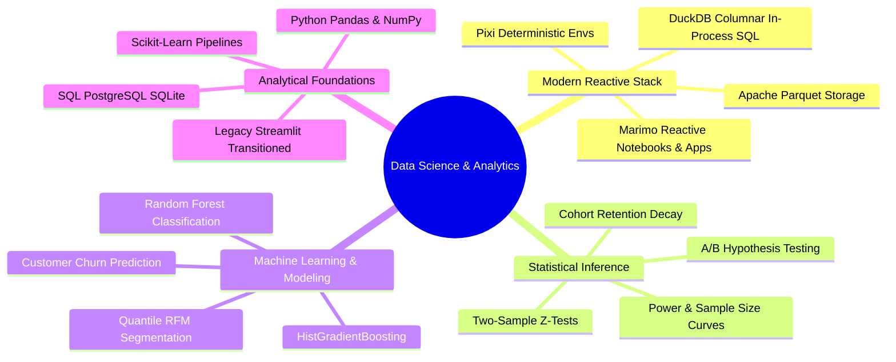

  # Hi there, I'm Haider Ali 👋
  ### 📊 Data Scientist & Analytics Engineer
  
  

    <a href="https://haiderdaportfolio.vercel.app"><b>🌐 Portfolio</b></a> &nbsp;•&nbsp;
    <a href="mailto:haydermuhib@tutamail.com"><b>✉️ Email</b></a> &nbsp;•&nbsp;
    <a href="https://github.com/haydermuhib"><b>🐙 GitHub</b></a> &nbsp;•&nbsp;
    <b>🐧 Fedora Linux</b>
  

  

    
    &nbsp;&nbsp;
    
    &nbsp;&nbsp;
    
    &nbsp;&nbsp;
    
    &nbsp;&nbsp;
    
    &nbsp;&nbsp;
    
    &nbsp;&nbsp;
    
    &nbsp;&nbsp;
    
  

  

    <b>BS in Data Science</b> • Focused on <b>Product Growth Analytics</b>, <b>Statistical Experimentation</b> & <b>Decision Intelligence</b>.
  

  

    <i>Shifting the data science paradigm from legacy JSON notebooks (Jupyter) and monolithic dashboard frameworks (Streamlit) towards <b>reactive, git-friendly reproducible computing with Marimo</b> and <b>deterministic Rust-powered dependency management with Pixi</b>.</i>
  

---

### 🔬 Core Competencies & Tech Stack

| Layer | Primary / Modern Standard | Foundation & Transitioned Stack |
| :--- | :--- | :--- |
| **Reactive Apps & Notebooks** |  **`Marimo`** (Reactive, pure-Python, zero hidden state) | `Streamlit` *(transitioning)*, `Jupyter` *(legacy)* |
| **Package & Env Management** |  **`Pixi`** (Deterministic, multi-platform, Rust-backed) | `Pip`, `Venv`, `Conda` |
| **Data Engine & Storage** |  **`DuckDB`**, **`Apache Parquet`** (Columnar, zero-copy) |  `PostgreSQL`, `SQLite` |
| **Data Processing & ML** |  `Pandas`, `NumPy`, `Scikit-Learn (HistGradientBoosting)` | `Cohort Decay Matrices`, `RFM Quintiles`, `Random Forest` |
| **Visualizations** |  `Plotly`, `Matplotlib (OO Architecture)` |  `Seaborn (Statistical Distributions)` |
| **Operating System & Tooling** |  `Fedora Linux`, `Git / GitHub CLI`, `Docker` | `Bash Automation`, `POSIX Scripts` |

---

### 🚀 Flagship & Featured Projects

<table>
  <!-- FLAGSHIP: MARIMO + PIXI + DUCKDB -->
  <tr>
    <td width="100%">
      

        <h3>⚡ Flagship: CardioPulse — Clinical Risk & Readmission Intelligence</h3>
        
<b>Modern Stack:</b> Marimo Reactive Notebook & Web App • Pixi • DuckDB • Scikit-Learn • Plotly

      

      
      
An end-to-end clinical data science platform analyzing <b>100,000 inpatient encounters</b> to predict 30-day unplanned hospital readmissions. Showcases a modern reactive architecture ditching traditional Jupyter/Streamlit constraints for ultra-fast in-memory analytical queries.

      
      <ul>
        <li><b>High-Throughput Analytics:</b> Sub-50ms analytical queries directly over columnar Parquet via <b>DuckDB</b> (100k records compressed to 533 KB ZSTD).</li>
        <li><b>Reactive Architecture:</b> Built entirely as a reproducible, git-friendly <b>Marimo</b> reactive application managed deterministically with <b>Pixi</b>.</li>
        <li><b>Predictive Power:</b> Class-balanced <code>HistGradientBoosting</code> pipeline achieving <b>0.804 ROC-AUC</b> with a calibrated triage threshold capturing 78.5% of high-risk readmissions prior to discharge.</li>
        <li><b>Reliability:</b> Backed by 17 automated unit tests covering ETL, DuckDB queries, and Plotly visual components.</li>
      </ul>
      
      

        <a href="https://huggingface.co/spaces/haydermuhib/hospital-readmission-marimo"><b>🌐 Launch Interactive Marimo App (Hugging Face)</b></a> • 
        <a href="https://github.com/haydermuhib/hospital-readmission-marimo"><b>📂 Explore GitHub Repository</b></a>
      

    </td>
  </tr>

  <!-- PROJECT 01 -->
  <tr>
    <td width="100%">
      

        <h3>🛒 01. E-Commerce Product Analytics & Experimentation Engine</h3>
        
<b>Discipline:</b> Supervised ML (Churn Classification) • Statistical A/B Testing • Product Growth Analytics

      

      
      
An end-to-end analytical platform evaluating over <b>540,000 real-world international retail transactions</b>. Solves rapid post-purchase churn and misallocated acquisition spend through rigorous statistical modeling and predictive machine learning.

      
      <ul>
        <li><b>Retention Dynamics:</b> Modeled monthly cohort decay, exposing an immediate 60% attrition cliff within the first 30 days that settles into stable recurring buying patterns.</li>
        <li><b>RFM Segmentation:</b> Isolated top-tier VIP Champions who generate &gt;35% of total gross revenue despite comprising &lt;8% of the customer base.</li>
        <li><b>Predictive Churn Engine:</b> Deployed a Scikit-Learn Random Forest churn classifier paired with a dynamic checkout funnel A/B testing simulator (Two-Sample Z-proportion hypothesis testing & power curves).</li>
        <li><b>Stack:</b> Python, SQLite, Scikit-learn, Matplotlib/Seaborn OO APIs, Neumorphic Dark Streamlit UI.</li>
      </ul>
      
      

        <a href="https://01ecommerce-analytics.streamlit.app/"><b>🌐 View Live Streamlit App</b></a> • 
        <a href="https://github.com/haydermuhib/01_ecommerce_product_analytics"><b>📂 Explore GitHub Repository</b></a>
      

    </td>
  </tr>

  <!-- PROJECT 02 -->
  <tr>
    <td width="100%">
      

        <h3>👥 02. User Cohort & RFM Lifecycle Analytics</h3>
        
<b>Discipline:</b> Customer Lifecycle Diagnostics • CRM Strategy • Retention Decay Modeling

      

      
      
A diagnostic behavioral analytics suite evaluating multi-market customer purchasing patterns over a 12+ month lifecycle window to identify revenue concentration and prevent customer churn.

      
      <ul>
        <li><b>Retention Cliff Identification:</b> Quantified acquisition decay from 100% down to 20%–25% by month 1, establishing the first 30 days as the critical window for automated lifecycle intervention.</li>
        <li><b>Revenue Pareto Distribution:</b> Demonstrated that Champions and Loyal segments represent ~40% of customer headcount but drive over 75% of cumulative sales revenue.</li>
        <li><b>Data Integrity Architecture:</b> Segregated guest checkouts (24% of volume) from individual repeat buyer matrices to prevent cohort dilution.</li>
        <li><b>Stack:</b> Python, Pandas, Matplotlib, Seaborn Heatmaps, Streamlit, Pixi.</li>
      </ul>
      
      

        <a href="https://02usercohortrfmanalytics.streamlit.app/"><b>🌐 View Live Streamlit App</b></a> • 
        <a href="https://github.com/haydermuhib/02_user_cohort_rfm_analytics"><b>📂 Explore GitHub Repository</b></a>
      

    </td>
  </tr>

  <!-- PROJECT 03 -->
  <tr>
    <td width="100%">
      

        <h3>🏢 03. People Analytics: Employee Exit Survey Diagnostics</h3>
        
<b>Discipline:</b> People & Talent Analytics • Cross-Institutional Survey Harmonization • Attrition Modeling

      

      
      
A diagnostic workforce analytics solution analyzing voluntary resignations across Queensland educational bodies (DETE vs. TAFE) to isolate attrition drivers by career tenure.

      
      <ul>
        <li><b>Tenure-Driven Dissatisfaction:</b> Discovered that veteran personnel (11+ years of service) resign due to dissatisfaction at 1.6x the rate of early-career employees (52.6% vs. 32.6%).</li>
        <li><b>Institutional Disparity:</b> Quantified structural workload fatigue and administrative friction, showing DETE experienced significantly higher resignation dissatisfaction (46.5%) than TAFE (30.2%).</li>
        <li><b>Schema Harmonization:</b> Cleaned and standardized two disparate survey architectures across 6,600+ raw entries and 3,868 voluntary resignations into a high-performance Apache Parquet datastore.</li>
        <li><b>Stack:</b> Python, Regex, Columnar Parquet, Matplotlib, Streamlit.</li>
      </ul>
      
      

        <a href="https://03employeeexitsurveys.streamlit.app/"><b>🌐 View Live Streamlit App</b></a> • 
        <a href="https://github.com/haydermuhib/03_employee_exit_surveys"><b>📂 Explore GitHub Repository</b></a>
      

    </td>
  </tr>
</table>

---

### ⚡ Data Infrastructure & Automation Highlights

- **[learn-duckdb](https://github.com/haydermuhib/learn-duckdb):** Deep-dive into vectorized in-process analytical SQL, fast Parquet scanning, and analytical query optimization.
- **[GMapsScraper](https://github.com/haydermuhib/GMapsScraper):** High-throughput, multithreaded automated data extraction engine for spatial lead generation and market intelligence.

---

### 📈 GitHub Analytics

  
  &nbsp;&nbsp;
  

   
  

---

  
  ### 📬 Let's Connect & Collaborate
  
  Whether you are looking to discuss **data analytics roles**, **predictive modeling**, or **modern reactive data architectures**:
  
  
  
  

  Designed & engineered on Fedora Linux 🐧

