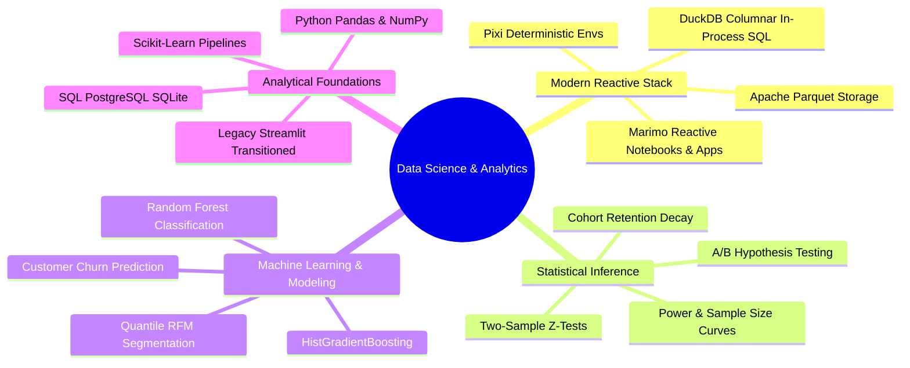

  

    <b>Theme:</b> <a href="README.md">🌙 Switch to Dark Mode</a> &nbsp;|&nbsp; <b>☀️ Light Mode (Active)</b>
  

  # Hi there, I'm Haider Ali 👋
  ### 📊 Data Scientist & Analytics Engineer
  
  

    <a href="https://haiderdaportfolio.vercel.app"><b>🌐 Portfolio</b></a> &nbsp;•&nbsp;
    <a href="mailto:haydermuhib@tutamail.com"><b>✉️ Email</b></a> &nbsp;•&nbsp;
    <a href="https://github.com/haydermuhib"><b>🐙 GitHub</b></a> &nbsp;•&nbsp;
    <b>🐧 Fedora Linux</b>
  

  

    
    &nbsp;&nbsp;
    
    &nbsp;&nbsp;
    
    &nbsp;&nbsp;
    
    &nbsp;&nbsp;
    
    &nbsp;&nbsp;
    
    &nbsp;&nbsp;
    
    &nbsp;&nbsp;
    
  

  

    <b>BS in Data Science</b> • Focused on <b>Product Growth Analytics</b>, <b>Statistical Experimentation</b> & <b>Decision Intelligence</b>.
  

  

    <i>Shifting the data science paradigm from legacy JSON notebooks (Jupyter) and monolithic dashboard frameworks (Streamlit) towards <b>reactive, git-friendly reproducible computing with Marimo</b> and <b>deterministic Rust-powered dependency management with Pixi</b>.</i>
  

---

### 🔬 Core Competencies & Modern Stack

| Layer | Primary / Modern Standard | Foundation & Transitioned Stack |
| :--- | :--- | :--- |
| **Reactive Apps & Notebooks** |  **`Marimo`** (Reactive, pure-Python, zero hidden state) | `Streamlit` *(transitioning)*, `Jupyter` *(legacy)* |
| **Package & Env Management** |  **`Pixi`** (Deterministic, multi-platform, Rust-backed) | `Pip`, `Venv`, `Conda` |
| **Data Engine & Storage** |  **`DuckDB`**, **`Apache Parquet`** (Columnar, zero-copy) |  `PostgreSQL`, `SQLite` |
| **Data Processing & ML** |  `Pandas`, `NumPy`, `Scikit-Learn (HistGradientBoosting)` | `Cohort Decay Matrices`, `RFM Quintiles`, `Random Forest` |
| **Visualizations** |  `Plotly`, `Matplotlib (OO Architecture)` |  `Seaborn (Statistical Distributions)` |
| **Operating System & Tooling** |  `Fedora Linux`, `Git / GitHub CLI`, `Docker` | `Bash Automation`, `POSIX Scripts` |

---

### 🚀 Flagship & Featured Projects

#### ⚡ Flagship: CardioPulse — Clinical Risk & Readmission Intelligence
> **Modern Architecture:** Marimo Reactive Web App • Pixi • DuckDB • Scikit-Learn • Plotly  
> **Dataset Scale:** 100,000 Inpatient Encounters (533 KB ZSTD Columnar Parquet)

An end-to-end clinical data science platform analyzing **100,000 inpatient encounters** to predict 30-day unplanned hospital readmissions. Showcases a modern reactive architecture ditching traditional Jupyter/Streamlit constraints for ultra-fast in-memory analytical queries.

* ⚡ **High-Throughput Analytics:** Sub-50ms analytical queries directly over columnar Parquet via **DuckDB** (100k records compressed to 533 KB ZSTD).
* 🔄 **Reactive Architecture:** Built entirely as a reproducible, git-friendly **Marimo** reactive application managed deterministically with **Pixi**.
* 🎯 **Predictive Power:** Class-balanced `HistGradientBoosting` pipeline achieving **0.804 ROC-AUC** with a calibrated triage threshold capturing 78.5% of high-risk readmissions prior to discharge.
* 🧪 **Reliability:** Backed by 17 automated unit tests covering ETL, DuckDB queries, and Plotly visual components.

🔗 **[Launch Interactive Marimo App (Hugging Face)](https://huggingface.co/spaces/haydermuhib/hospital-readmission-marimo)** &nbsp;|&nbsp; 📂 **[Explore GitHub Repository](https://github.com/haydermuhib/hospital-readmission-marimo)**

---

#### 🛒 01. E-Commerce Product Analytics & Experimentation Engine
> **Discipline:** Supervised ML (Churn Classification) • Statistical A/B Testing • Product Growth Analytics  
> **Dataset Scale:** 540,000+ Retail Transactions • Cleaned SQLite Analytical Engine

An end-to-end analytical platform evaluating over **540,000 real-world international retail transactions**. Solves rapid post-purchase churn and misallocated acquisition spend through rigorous statistical modeling and predictive machine learning.

* 📉 **Retention Dynamics:** Modeled monthly cohort decay, exposing an immediate 60% attrition cliff within the first 30 days that settles into stable recurring buying patterns.
* 👑 **RFM Segmentation:** Isolated top-tier VIP Champions who generate >35% of total gross revenue despite comprising <8% of the customer base.
* 🧠 **Predictive Churn Engine:** Deployed a Scikit-Learn Random Forest churn classifier paired with a dynamic checkout funnel A/B testing simulator (Two-Sample Z-proportion hypothesis testing & power curves).
* 🛠️ **Stack:** Python, SQLite, Scikit-learn, Matplotlib/Seaborn Object-Oriented APIs, Neumorphic Dark Streamlit UI.

🔗 **[View Live Streamlit App](https://01ecommerce-analytics.streamlit.app/)** &nbsp;|&nbsp; 📂 **[Explore GitHub Repository](https://github.com/haydermuhib/01_ecommerce_product_analytics)**

---

#### 👥 02. User Cohort & RFM Lifecycle Analytics
> **Discipline:** Customer Lifecycle Diagnostics • CRM Strategy • Retention Decay Modeling  
> **Dataset Scale:** Multi-Market International Retail Purchasing • 12+ Month Window

A diagnostic behavioral analytics suite evaluating multi-market customer purchasing patterns over a 12+ month lifecycle window to identify revenue concentration and prevent customer churn.

* 🧗 **Retention Cliff Identification:** Quantified acquisition decay from 100% down to 20%–25% by month 1, establishing the first 30 days as the critical window for automated lifecycle intervention.
* 💰 **Revenue Pareto Distribution:** Demonstrated that Champions and Loyal segments represent ~40% of customer headcount but drive over 75% of cumulative sales revenue.
* 🛡️ **Data Integrity Architecture:** Segregated guest checkouts (24% of volume) from individual repeat buyer matrices to prevent cohort dilution.
* 🛠️ **Stack:** Python, Pandas, Matplotlib, Seaborn Heatmaps, Streamlit, Pixi.

🔗 **[View Live Streamlit App](https://02usercohortrfmanalytics.streamlit.app/)** &nbsp;|&nbsp; 📂 **[Explore GitHub Repository](https://github.com/haydermuhib/02_user_cohort_rfm_analytics)**

---

#### 🏢 03. People Analytics: Employee Exit Survey Diagnostics
> **Discipline:** People & Talent Analytics • Cross-Institutional Survey Harmonization • Attrition Modeling  
> **Dataset Scale:** 6,600+ Survey Records • 3,868 Voluntary Resignations (DETE vs. TAFE)

A diagnostic workforce analytics solution analyzing voluntary resignations across Queensland educational bodies (DETE vs. TAFE) to isolate attrition drivers by career tenure.

* ⏳ **Tenure-Driven Dissatisfaction:** Discovered that veteran personnel (11+ years of service) resign due to dissatisfaction at 1.6x the rate of early-career employees (52.6% vs. 32.6%).
* ⚖️ **Institutional Disparity:** Quantified structural workload fatigue and administrative friction, showing DETE experienced significantly higher resignation dissatisfaction (46.5%) than TAFE (30.2%).
* 🗃️ **Schema Harmonization:** Cleaned and standardized two disparate survey architectures across 6,600+ raw entries and 3,868 voluntary resignations into a high-performance Apache Parquet datastore.
* 🛠️ **Stack:** Python, Regular Expressions, Columnar Parquet, Matplotlib, Streamlit.

🔗 **[View Live Streamlit App](https://03employeeexitsurveys.streamlit.app/)** &nbsp;|&nbsp; 📂 **[Explore GitHub Repository](https://github.com/haydermuhib/03_employee_exit_surveys)**

---

### ⚡ Data Infrastructure & Automation Highlights

* **[learn-duckdb](https://github.com/haydermuhib/learn-duckdb):** Deep-dive into vectorized in-process analytical SQL, fast Parquet scanning, and analytical query optimization.
* **[GMapsScraper](https://github.com/haydermuhib/GMapsScraper):** High-throughput, multithreaded automated data extraction engine for spatial lead generation and market intelligence.

---

### 📈 GitHub Analytics

  
  &nbsp;&nbsp;
  

   
  

---

  
  ### 📬 Let's Connect & Collaborate
  
  Whether you are looking to discuss **data analytics roles**, **predictive modeling**, or **modern reactive data architectures**:
  
  

    <a href="mailto:haydermuhib@tutamail.com"><b>✉️ haydermuhib@tutamail.com</b></a> &nbsp;•&nbsp;
    <a href="https://haiderdaportfolio.vercel.app"><b>🌐 haiderdaportfolio.vercel.app</b></a> &nbsp;•&nbsp;
    <a href="https://github.com/haydermuhib"><b>🐙 @haydermuhib</b></a>
  

  Designed & engineered on Fedora Linux 🐧

